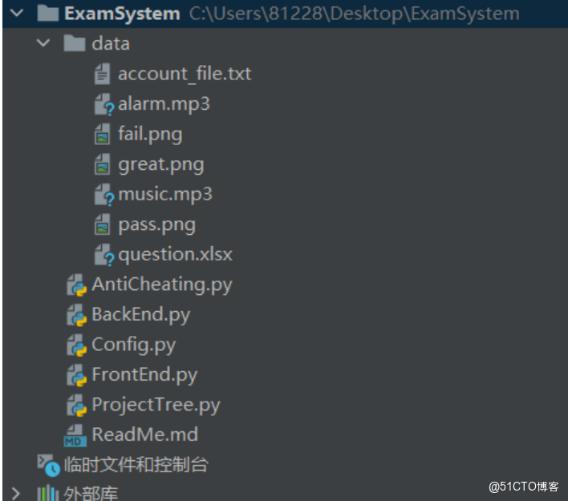
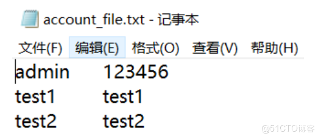
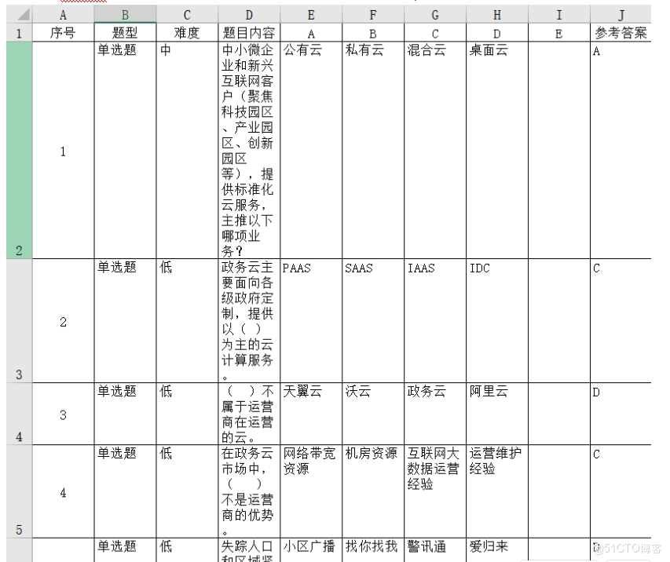
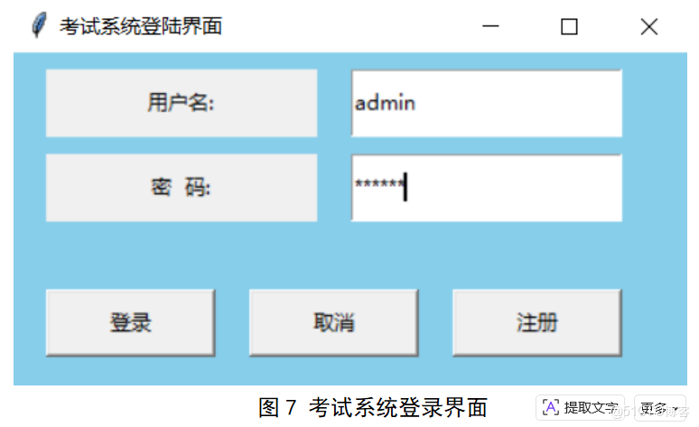
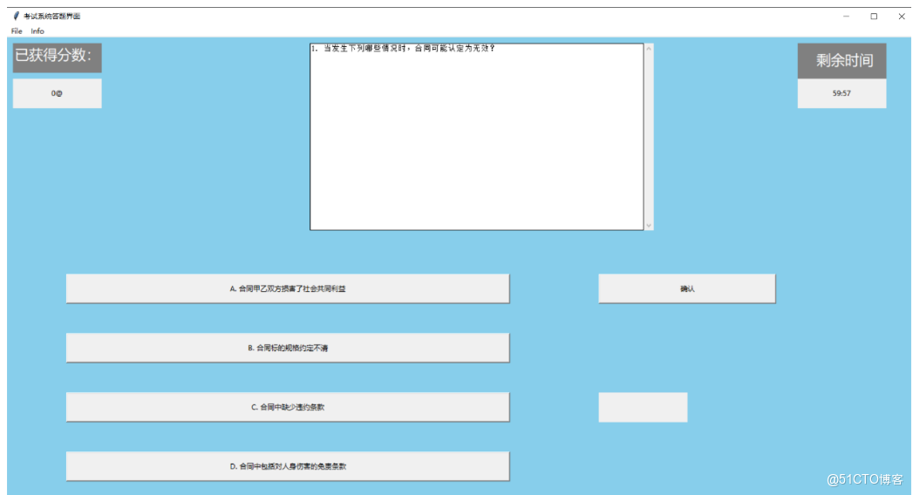
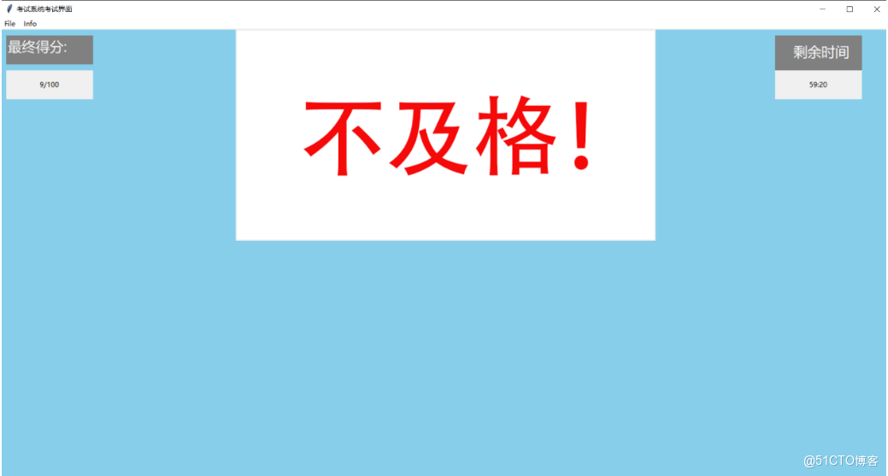

# Python+Tkinter-based Automated Test Paper Generation and Scoring System

Project Overview: Python Language Program Design - Final Course Project: Implement an automatic test paper generation and grading system using the Python programming language. The main features of the software include...

## Project Overview

Python Language Program Design: Final Course Project

Implement an automatic test paper assembly and grading system using Python. The main features of the software include: randomly selecting questions from the question bank to automatically form a test paper with a total score of 100 points. Implement the interface for candidates to answer questions. Implement automatic grading and scoring functionality; Wait.

This project has been completed: the timing of the exam, automatic question assembly, objective questions automatically scoring, automatic grading and the design of the examination interface.

## Project Structure

```
----ExamSystem\
    |----data\
    |    |----account_file.txt
    |    |----alarm.mp3
    |    |----fail.png
    |    |----great.png
    |    |----pass.png
    |    |----question.xlsx
    |----AntiCheating.py
    |----BackEnd.py
    |----Config.py
    |----FrontEnd.py
    |----ProjectTree.py
    |----ReadMe.md
```

## Functionality Characteristics

### Front-end:

Complete the login and registration functionality to verify the identity of the candidate. If the identity is correct, proceed to the examination interface; otherwise, re-enter.

Wait briefly for the exam interface to randomly assign questions, then begin answering. Scores are immediately awarded after each question is completed, and the total score is displayed after all questions have been answered: 85 points or above indicates passing. Otherwise, it is considered non-compliant.

The exam begins at the start of the timer, and it will automatically end the exam if it exceeds the time limit. Scores are then calculated, and music is played.

### Backend:

To facilitate deployment, information and question bank are stored in a file-read/write manner instead of using databases.

Complete verification of the identity information of the examinees, automatically generate test questions based on the front-end requirements.

## Environmental Dependence

Windows10 + Python 3.8

## Usage and Testing

The file directory must be dragged and dropped onto the local machine completely. All file reading and writing will automatically detect the current directory.

Run FrontEnd.py.

During testing, login is required. There is an admin account named "admin" with the password 123456; there are two test accounts named "test1" and "test2", with the same password and account name; as well as a blank account with an empty password for debugging purposes, which can be directly logged in.

Select an option, and the text box on the right side of the option will display the current option. Press the confirm key to complete this question. If the result is correct, the score at the top left corner will change.

I. Experiment Project Name: Automated Assignment and Scoring Examination System Implement the interface for candidates to answer questions in the examination. Implement automatic grading and scoring functionality; Wait. III. Experimental requirements 1. The types of questions include individual multiple-choice questions, fill-in-the-blank questions, and judgment questions, etc. 2. The question bank can be implemented using text files, CSV files, or databases, etc. 3. Require the necessary comments to be marked in the source code. 4. Necessary explanations of the usage and operational methods of the program are required. 5. The course design must include the source code of the program and the test question bank documentation (to facilitate grading and testing). 4. Experimental Equipment (Equipment, Components) Processor: Intel® Core™ i5-8300H CPU @ 2.30GHz 2.30GHz Installed Memory (RAM): 8GB System Type: 64-bit operating system based on x64 processor IDE: JetBrains PyCharm (Community Version) 2020.2.1 Python Interpreter: Python 3.8 5.2 Framework Design The overall framework and structure of the system are shown in Figure 1.



Figure 1 System Overall Framework and Structure Diagram

The following sections will introduce the functions and roles of each component: FrontEnd.py, which primarily includes front-end classes, mainly implementing registration and quiz interfaces, as well as data invocation functionalities. BackEnd.py, which mainly includes backend classes, primarily implements functions such as checking if the user exists, whether the account password is correct, adding new users, generating random question numbering, and retrieving questions for the frontend. AntiCheating.py, which mainly includes anti-cheating demonstration programs, mainly implements functions such as forcibly closing mainstream text editors and web browsers, and forcing to clear the system clipboard. ProjectTreee.py, which mainly includes cheating prevention demonstrations and primarily implements the function of generating project structure tree diagrams. Config.py, which mainly implements functions such as getting the current path, finding the user information table and question bank. The data folder contains the question bank, question.xlsx, the music that plays automatically after the exam ends, music.mp3, the text file account_file.txt containing the storage administrator's and tester's accounts, as well as images reflecting the exam results: fail.png, pass.png, great.png. 5.3 Specific Implementation

VI. Data and Project Demonstration

6.1 The content of account_file.txt is shown in Figure 2.



Figure 2: Diagram of the contents in account_file.txt

The first column is the account name, and the second column is the account password. Among them, the admin account "admin" corresponds to the password "123456"; the test accounts "test1" and "test2" have the same password as their names. The question bank "question.xlsx" contains multiple-choice questions, true/false questions, and judgment questions, as shown in Figure 3.



Figure 3: A diagram of the content in question.xlsx

6.2 Project Demonstration

Run FrontEnd.py, firstly enter the login interface of the examination system, input the username and password, click login as shown in Figure 7.



Figure 7 Exam System Login Interface

Upon successful login, enter the exam system's question-solving interface as shown in Figure 8.



Figure 8 Examination System Answering Interface

After completing the question, display the score and play music as shown in Figure 9.



Figure 9: Examination System Displaying Scores

VII. Summary and Reflections: This course design successfully implemented an automatic test paper assembly and grading system using Python programming. The project primarily achieved the following functionalities: randomly selecting questions from a question bank to form a test paper, creating an interface for students to take the exam, automatically scoring and grading, and demonstrating anti-cheating measures. This enhanced our programming skills in Python.


## Payment

Here is a pay link on Stripe ( https://buy.stripe.com/3cs8yP7sY87d0vu9AB ). Please contact me lonlonago@foxmail.com after funding $89, and I will send you a complete data files , thank you!


